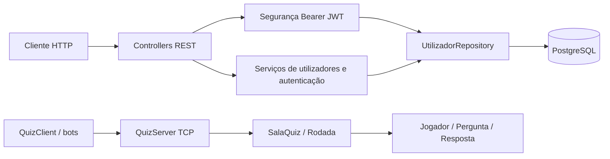

# Arquitectura — fundação do backend

Actualizado em 21 de Outubro de 2026. A Fase 2 implementa Spring Boot 3.5.16, Java 21, Spring Security, JPA, Flyway e PostgreSQL 17. H2 é usado apenas nos testes Maven.

## Componentes implementados

Os processos HTTP e TCP são independentes nesta entrega. A API ainda não controla partidas TCP nem salas de avaliação. A futura interface web consumirá a API; a integração de salas e os eventos em tempo real pertencem às fases 5 e 6.

## Organização

- `quizrace.api`: arranque Spring Boot, controladores e erros HTTP.
- `quizrace.api.user`: conta persistida, perfis, DTOs, serviço e repositório.
- `quizrace.api.security`: hash de palavras-passe, JWT, autorização e administrador inicial.
- `quizrace.model`, `server`, `network`, `service`: jogo original, mantido.
- `db/migration/V1__utilizadores.sql`: esquema versionado; Hibernate valida e não cria tabelas.

A conta `Utilizador` tem identidade persistente. `Jogador` continua a representar estado de uma partida. Não há associação entre ambos nesta fase.

## Segurança implementada

BCrypt com custo 12; palavras-passe entre 12 caracteres e 72 bytes UTF-8. Tokens HS256 duram 15 minutos, são enviados em `Authorization: Bearer` e validam assinatura, emissor e prazo. A chave vem de `QUIZ_JWT_SECRET`, com pelo menos 32 bytes; recomenda-se gerar 32 bytes aleatórios em hexadecimal.

Em cada pedido autenticado, o backend consulta o estado, perfil e versão de autenticação da conta. Desactivar/reactivar ou alterar perfil invalida os tokens anteriores. A autorização usa o perfil actual no banco. Não há sessão HTTP ou cookie de autenticação; por isso CSRF está desactivado neste contrato Bearer. O futuro frontend deve manter o token em memória e não inventar autenticação baseada em cookies sem rever CSRF.

As alterações administrativas usam uma linha de bloqueio no banco, transacção e versionamento optimista. Não é permitido retirar o último administrador activo. A criação também depende da unicidade de email na base de dados.

O administrador inicial é criado somente quando a tabela está vazia, através de variáveis de ambiente. Reiniciar não redefine contas. Não existe auto-registo público.

## Construção e execução

`mvn verify` gera `quizrace.jar` para CLI/TCP e `quizrace-api.jar` executável com dependências para HTTP. O Dockerfile original continua a executar TCP; `Dockerfile.api` e `compose.api.yml` executam API e PostgreSQL. A porta da API fica ligada ao localhost por defeito.

## Decisões e limites

JWT foi mantido conforme a proposta aprovada; a consulta ao banco permite revogar privilégios imediatamente. H2 acelera os testes, mas não substitui a validação com PostgreSQL real. React/TypeScript permanece planeado para a Fase 3. Nenhum mecanismo de eventos foi acrescentado nesta fase.

Referências: [requisitos Spring Boot 3.5](https://docs.spring.io/spring-boot/3.5/system-requirements.html), [validação JWT Spring Security](https://docs.spring.io/spring-security/reference/servlet/oauth2/resource-server/jwt.html). A linha 3.5 foi mantida por compatibilidade com a proposta; suporte e actualizações deverão ser revistos antes de publicação em produção.
