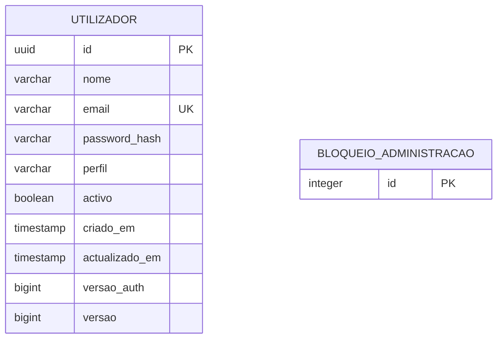

# Modelo de dados implementado

Migração: `src/main/resources/db/migration/V1__utilizadores.sql`.

O email é normalizado para minúsculas, com unicidade e restrição no banco. O nome tem 2–100 caracteres após remover espaços laterais. Os perfis permitidos são `ADMINISTRADOR`, `DOCENTE` e `ESTUDANTE`. UUID e datas são gerados no servidor.

`password_hash` contém BCrypt; não existe coluna com palavra-passe original. DTOs públicos não expõem hash, versão de autenticação ou credenciais.

`versao_auth` é incrementada em alterações administrativas e invalida tokens anteriores. `versao` serve o controlo optimista do JPA. A linha única de `bloqueio_administracao` serializa alterações administrativas e bootstrap entre instâncias, protegendo a regra do último administrador.

O PostgreSQL fica num volume Docker nomeado. `docker compose -f compose.api.yml down` preserva esse volume; `down -v` apaga os dados e não deve ser usado para encerrar a instalação normal.

Perguntas continuam no ficheiro de recursos. Partidas, resultados, avaliações e salas ainda não são persistidos; serão modelados nas fases correspondentes. Não se deve confundir os dados de conta com o estado efémero de `Jogador`.
