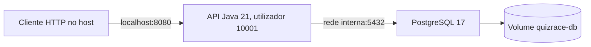

# Docker da fundação académica

O jogo TCP usa o `Dockerfile` e `docker-compose.yml` existentes. A API usa `Dockerfile.api` e `compose.api.yml`. São projectos Compose distintos.

## Implantação implementada



A imagem de build usa Maven 3.9.9/JDK 21 e executa `mvn verify`. A imagem final contém JRE 21 e o JAR executável. O healthcheck da base de dados condiciona o arranque da API.

Configurar `.env` conforme [instalação](08-instalacao-e-execucao.md) e executar:

```bash
docker compose -f compose.api.yml up --build -d
docker compose -f compose.api.yml ps
docker compose -f compose.api.yml logs -f api
docker compose -f compose.api.yml down
```

O volume mantém os dados quando se executa `down` sem `-v`. O PostgreSQL não expõe porta no host. A publicação externa, HTTPS e backups pertencem ao trabalho futuro.

`scripts/verificar-api.sh` cria um projecto com nome exclusivo para ensaio e elimina apenas o volume temporário desse projecto ao terminar. As imagens de build permanecem em cache.
